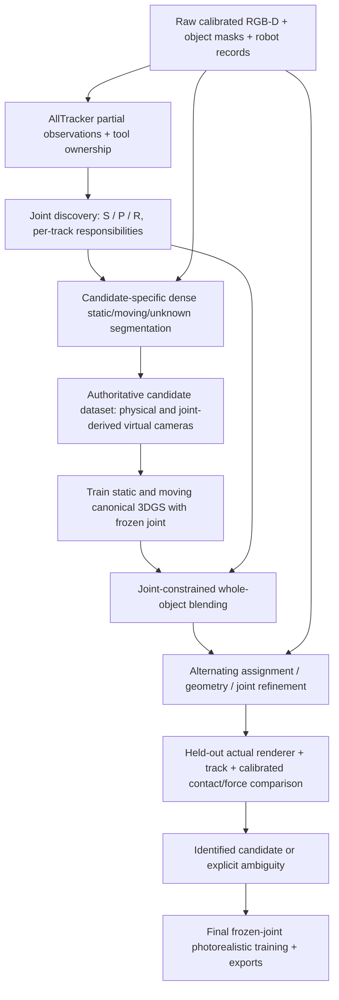

# ForceArtGS: end-to-end joint-aware part discovery and articulated Gaussian reconstruction

**Implementation contract for Codex — 2026-11-18**  
**Target:** `~/ForceArtGS` (`SamueleMara/ForceArtGS`), existing `freeartgs` environment.  
**Purpose:** make the improved joint motion and static/moving support estimator the authoritative frontend of FreeArtGS, and use real RGB-D Gaussian rendering to improve (rather than overwrite) those estimates.  
**Scope:** implementation, numerical tests, reproducible real-scene validation, and downstream reconstruction. This is not a request to run the vanilla pipeline again or to patch only the final joint JSON.

## 0. Read this first: instructions and current evidence

Read these existing files in the checkout before editing:

- `FREEARTGS_PHASE1_JOINT_AWARE_MOTION_TCP_FORCE_CODEX_SPEC.md` (original exact joint and sliding-contact contract).
- `FORCEARTGS_JOINT_DISCOVERY_NEXT_STEPS_CODEX.md` (A–G: RGB-D audit, robust inference, contact calibration, force, real-render validation).
- `JOINT_DISCOVERY_NEXT_STEPS_IMPLEMENTATION_REPORT.md` (local overnight work; inspect actual current version).
- `docs/joint_discovery_phase1.md`, `docs/multiview_root_cause_black_box.md`, `docs/contact_force_convention.md`, `estimotion_2part/joint_discovery/README.md`.
- User-provided Codex transcript `Pasted markdown(20261118-063831).md` (overnight real-scene experiments; use the local logs/artifacts for verification). Earlier report `Pasted markdown(20261117-140208).md` describes the previous estimator state.

This file supersedes the proposed H1–H4-first/H5-later production integration. Dense part discovery (H5) is **mandatory before training the new individual parts**. A final-stage-only H1 experiment is useful as a diagnostic ablation, never the completed method.

### 0.1 Evidence at specification time (not new ground truth)

The 2026-11-18 overnight joint stream ran with `git=468071f`, `dirty=34`. The public repository checked for this specification is the parent commit `468071f2dbd9c5f22f3268c0733d516736681b1d` and its Nerfstudio gitlink `b1ac879fe61c168dd3f6ef81ffec89f86f6d050f`. The local checkout can differ: inspect it, do not reset it. Earlier tests: 41 new joint-discovery tests passed; rerun current suite because A–F were subsequently modified. The latest cluster/observability changes make several previously confident decisions ambiguous. Do not undo those changes simply to get more positive labels.

| Scene | Clip (RGB-D indices, inclusive) | Cameras | Latest decision | R span / radius; P span |
|---|---|---|---|---|
| Black box | `70:128:2` | 001,002 | ambiguous | 2.8° / 1.21 m; 6.3 cm |
| Black box stress | same | 000,001,002 | ambiguous | 6.9° / 0.419 m; 5.6 cm |
| Orange suitcase | `50:120:2` | 001,002 | ambiguous | 15.6° / 0.614 m; 17.2 cm |
| Orange suitcase stress | same | 000,001,002 | ambiguous | 2.0° / 5.074 m; 18.1 cm |
| Red fridge | `90:148:2` | 001,002 | revolute | 18.9° / 0.315 m; 10.4 cm |
| Robot dog | `80:140:2` | 001,002 | ambiguous | 2.5° / 2.163 m; 9.5 cm |
| White drawer | check current manifest (prior `150:330:6`) | 001,002 | ambiguous, P preference | 1.0° / 8.917 m; 16.2 cm |

The standalone method must not be judged by these spans alone. Candidate geometry is not independently certified. In the prior study the black-box tracker-free reference is approximately 15–21° at the clip end (cam_000 near 15°); cam_001/002 depth/track drift and calibration disagreement remain unresolved. The latest report explicitly says A pass, B fail, C pass, D fail, E abstains on real data, F partial, G not run. Verify definitions against actual local report before citing these gate labels. No verified robot/force selection on real scenes; white drawer calibration explicitly invalid. These are limitations, not reasons to enable uncalibrated force.

Overnight standalone training stream (`overnight_real/train`) still used vanilla segmentation/ICP/pose blending/classifier. It is not the new method. At report time black box, suitcase, fridge completed, dog still running; check current status. All reported completed models output prismatic. The fridge's legacy blend poses have 24.3° first-to-last rotation but the mean-relative unsigned/IQR span is 3.8°, hence the <10° rule calls it prismatic. Black box full sequence has 15–16° pairwise rotation yet 4.9° classifier span. Matchbox has spurious 18–22° legacy rotation despite sliding; therefore fixing the angle metric or forcing R/P based on a threshold is not a substitute for joint model competition. Never compare full-episode vanilla to shortened new clips as a controlled A/B.

### 0.2 Hard requirements

1. In joint-aware mode **no legacy part mask, independent ICP motion, reference-camera motion propagation, free per-time SE(3) adjustment, or legacy joint classifier can be used implicitly**. Legacy mode stays the default and independently runnable. No silent fallback from ambiguity/errors to vanilla.
2. One fixed world frame W (calibrated metric robot base if verified); one shared joint state per acquisition time; physical cameras never move. The moving reference frame is W at `reference_time_index` (not necessarily t=0). Explicitly track all Nerfstudio/PLY normalization transforms.
3. Joint candidates, dense memberships, canonical part geometry and final renderer cooperate, but no unconstrained time-dependent deformation. Unknown is a real label. A track or pixel on the moving part may not be moving observably (e.g., hinge axis).
4. TCP is a known instantaneous *contact location*, NOT a fixed material point. Slip is tangential to the physical contact surface, not necessarily parallel to the TCP trajectory or to the material trajectory. Only use confirmed contact intervals. Force is physical evidence conditional on calibration and observability; no universal tangent-force classifier, no rigid grasp assumption.
5. Keep original Gaussian rasterizer, part reconstruction, appearance models and RGB-D losses where correct. Modify consumers/metadata/loss masking as required. Do not add a parallel unrelated reconstruction package, replace gsplat with point proxy, or pass a rendered image as a surrogate for a differentiable actual renderer.
6. No GT or hand-chosen hinge/lid height in production initialization, assignment, optimization, model selection or hyperparameter fitting. References are read only after predictions are saved, in explicit diagnostic evaluation. Preserve real camera intrinsics/extrinsics. Camera disagreement is evidence to report, not permission to optimize camera poses.
7. Retain R/P alternatives for ambiguous dynamic scenes; render them with comparable budgets. If still unidentifiable, report both candidates and `ambiguous/unobservable`; export diagnostic reconstructions, not a falsely identified articulated asset. Static/no-motion is an explicit separate outcome.
8. Implement and exercise the full data path before claiming success. Fail closed on mismatched hashes, scales, timestamp maps, missing masks, empty support, unverified transforms, or unsupported flags. Distinguish `NOT_RUN`, `UNAVAILABLE`, `ABSTAIN`, `FAILED`, `PASSED`. An exit code 0 or 30k iterations is not quality validation.

### 0.3 Repository and worktree safety

- Do not force push, rewrite history, reset, clean, delete branches, or modify source acquisitions. No unrelated changes. Inspect `git status --short`, `git rev-parse HEAD`, `git submodule status --recursive`, submodule status/diffs and `git remote -v`; archive an immutable patch/manifest for existing uncommitted work. Work on an explicitly named integration branch/worktree only after preserving local changes; if making a worktree would lose working changes, work on the current preserved checkout. Never overwrite overnight results.
- `.gitmodules` at inspected commit maps `reconstruction/nerfstudio` to `SamueleMara/FreeArtGS.git`, branch `nerfstudio-local`. This is a separate repository! Inspect exact installed code (`python -c 'import nerfstudio; print(nerfstudio.__file__)'`, `ns-train --help`) and actual submodule HEAD. Commit modifications on a dedicated submodule branch/fork under user control, then parent gitlink; do not accidentally push to original FreeArtGS main. Do not change unrelated submodule URLs. Ensure installation is editable or otherwise verified to load modified code. If publishing not explicitly requested, keep changes local and report commands/patches.
- New outputs under a fresh `results_18_11_26/forceartgs_joint_aware` or explicit `--output-root`, not baseline directories. Store source paths and hashes, never mutate raw scenes. Use atomic writes/rename for authoritative manifests. Capture stdout/stderr with `set -euo pipefail`, per-stage exit statuses and elapsed times. No global `find ... -delete` workaround.

## 1. Architecture and dependency graph



There is one branch per surviving H, not one scene-wide mask set shared by R/P. Fit S (static null) for scene motion evidence and, when meaningful, a comparable static rendering baseline. Use short, matched coarse branch stages first; full 30k stages only after selecting or explicitly requesting ambiguous diagnostic exports. A confident initial type is provisional until validation, not a license for the renderer to reclassify based on threshold. Preserve both candidates wherever possible; if resource constraints prune a branch, record `NOT_EVALUATED` and never claim a fair R/P comparison.

### 1.1 Where legacy stages must be bypassed

| Existing stage | Existing behavior/failure | New behavior |
|---|---|---|
| `pipelines/train_local_datasets.py` per-camera preprocess/tracking at ~404–405; `pipelines/freeartgs.sh` | per-view legacy frontend | explicit joint-aware route after raw conversion, before vanilla masks |
| `pipelines/tracking_dynamic_2part.sh`, `estimotion_2part/track_2part.py` | learned two free transforms; masks per camera | use existing AllTracker extraction only, joint-aware sparse fitting and dense segmentation |
| `preprocessing/bundle_preprocess.py`, `pipelines/icp.sh`, `icp/color_icp_gpu.py` | masks/PCDs/independent motion | bypass motion-producing code and any mask writers; reuse pure conversion utilities only after audit |
| `preprocessing/prepare_multiview.py` | reads `global_poses_{0,1}.npy`, chooses reference, swaps part IDs, propagates reference-camera trajectory | independent new builder, no reference-camera selection; part0 always S, part1 M |
| `reconstruction/generate_ply.py`, `pipelines/train_parts.sh` | uses part masks and pose lists | reuse with correct candidate-specific masks, per-view intrinsics and canonical units; add validity support |
| Nerfstudio `twopart_blend_dataparser.py`, `models/twopart_blend.py` | independently anchors both parts on first common image, enables 6D object pose adjustments | explicit transforms into same canonical world; fixed or exact one-DoF joint layer; no free pose adjustment |
| `pipelines/splatfacto_art.sh` | unconditional `preprocessing/estimate_joint.py` | require authoritative joint artifact, never call legacy estimator in new mode |
| Nerfstudio `splatfacto_art_dataparser.py`, `models/splatfacto_art.py` | loads `estimated_joint.json`; free joint-axis/origin/offset and per-frame state optimizations | load validated state; map units once; offset fixed, reference fixed, constrained refinements and explicit acceptance |
| final exporters/evaluators | legacy schemas, possible auto type inference | strict source provenance, direct world joint export; no reclassification |

Audit actual call graph and stage scripts before changes. If local code has newer hooks, adapt them rather than adding duplicates. Verified reference: parent `pipelines/freeartgs.sh`, `prepare_multiview.py`, `generate_ply.py`, `estimotion_2part/joint_discovery/exports.py`; submodule paths relative to `reconstruction/nerfstudio/nerfstudio/`: `data/dataparsers/twopart_blend_dataparser.py`, `data/dataparsers/splatfacto_art_dataparser.py`, `models/twopart_blend.py`, `models/splatfacto_art.py`. Discover actual depth model/dataparser and exporter paths via grep, not guessed filename.

## 2. Single authoritative joint/scene contract

Extend existing `JointCandidate`, `TrackObservations`, `FrameMap`, `CameraCalib`, `candidate_to_json`, `write_joint_states`; keep old output schema readable. Add versioned `JointAwareScene`/`JointBundle` loader (proposed module `estimotion_2part/joint_discovery/integration_contract.py`, immutable validation). Avoid serializing parameters in multiple conflicting formats. The authoritative version is a branch-scoped manifest plus state arrays; downstream legacy-compatible files are derived adapters only.

### 2.1 Geometry

Use column vectors and `T_AB` mapping B to A. For static A_S(t)=I. For moving branch H:

$$A_R(t)=[R_u(q_t),(I-R_u(q_t))o;0,1],\qquad A_P(t)=[I,q_tu;0,1].$$

`u` unit norm, `o` hinge-line point (R only; choose nearest point to fixed canonical support centroid a, so `(o-a)·u=0`). Prismatic origin `null` in authoritative file; legacy zero vector adapter only, not a physical parameter. One shared unwrapped signed q per acquisition time in rad or m. `q_ref=0`; do not silently shift reference to the first camera image. Canonical material coordinates are W at t_ref. `A_R` preserves hinge line and radii; `A_P` preserves point differences. Velocity fields `v_R=dot(q) u×(x-o)`, `v_P=dot(q)u`. Use exact finite relative motion `A(t)A(s)^-1` between observations, not an Euler velocity step. Velocity diagnostics measure radial/axial/tangential residuals; do not add raw finite-difference velocities as independent likelihood alongside the same tracks.

### 2.2 Source map and data types

Every image row must include `image_id`, `camera_id`, `time_index`, `rgbd_frame_index`, `source_frame_index`, `timestamp_s`, `file_path`, per-frame intrinsics/resolution, `physical_camera_sha`, `valid_rgb`, `valid_depth`, and label/validity paths. Source-frame IDs may differ from RGB-D frame IDs. Multiple images with same t share q exactly. Check duplicates, strict acquisition timestamps, source joins, shape, depth units and OpenCV conventions. Retain frames with no reliable evidence, mark invalid/unknown, do not renumber time indices after splitting. Explicit map for reversed input (chronological physics). Use a stable camera ordering and zero-padded timestamp-major stems compatible with legacy readers. Record `ref_time_index` and reference source ID. Never treat image index as joint index.

Required branch-scoped files (proposed):

```text
run_root/scene_name/
  input_manifest.json                 # raw scene, frame map, calibrations, config, software
  observations/                      # immutable sparse extraction, hashes
  discovery/                         # existing candidate JSON, states, support, validation
  branches/revolute/                  # analogous prismatic, optional static
    joint_authority/v000/
      authority.json                  # version, parent SHA, scene, H, q units, parameters, cov/status
      joint_states.npz                # q[T], q_valid[T], timestamp_s[T], source_frame_index[T]
      track_support.npz               # persistent probabilities and canonical anchors
      frame_map.json
      calibration.json
      provenance.json
    dense_support/v000/
      label_manifest.json
      diagnostics/                    # evidence/support, per-view disagreements, audit overlays
    dataset/v000/                     # names below
    part_0/ part_1/                    # checkpoints, PLY, normalization metadata
    twopart_blend/
    refinement/                       # validation, accepted authority updates (v001...)
    splatfacto-art/
    branch_eval.json
  selection.json                      # scores, uncertainty, selected branch or ambiguity
  final/                              # only if validated type; otherwise diagnostic branch locations
    articulation.json
    joint_authority.json              # reference + immutable final snapshot
    object_3dgs.ply
    3dgs_part_weight.txt
    evaluation.json
```

Use real folders, not names literally containing spaces as in abbreviated tree. If an existing file path is required by a downstream script, implement explicit compatibility layer; never let it become an independent source of truth. `authority.json` includes `schema_version`, `authority_id` (hash of canonical JSON + NPZ contents), `parent_authority_id`, `joint_type`, `axis_world`, `origin_world`, `reference_time_index`, `q_units`, `world_frame`, `fit_evidence_version`, `fit_covariance` with units and status, `decision_status` (candidate/provisional/identified/ambiguous), `source_hashes`, `derived_from`, `calibration_hash`, `frame_map_hash`, `observation_hash`, `support_hash`, `train_split_hash`. Arrays must be finite where valid. Validate proper SO(3) and SE(3), `q_ref=0`, `u` unit, hinge gauge, lengths, source timestamps. Never turn missing covariance into zero covariance. `q_valid` false means interpolated/unobservable with explicit uncertainty; may initialize but must not label a pixel confidently from that alone.

Authority write access only from discovery/refinement controller. Dataset/mask builders and training workers are read-only consumers. Each intermediate manifest includes consumed authority ID and schema. Explicit version bump on accepted joint update, re-evaluate labels, invalidate any dependent virtual cameras/part training artifacts or use explicit gauge-aware warm-start; old outputs remain immutable. Reject stale resume, not just timestamp filenames. Hash raw data provenance, per-view metadata, masks, frame map, tracker/extractor config/weights, code/backends, semantic settings and split. Reference ID must not be inferred by filename modification time.

## 3. Integration stage G1: dense static/moving/unknown segmentation

This is a new component, not the old SAM2 moving mask. Implement `dense_support.py` plus `dense_evidence.py` and `dense_export.py` within the current `joint_discovery/` package (or equivalent clear modules). Reuse existing observation, robust likelihood, calibrated projection and DINO/SAM2 tools if appropriate; do not reuse legacy segmentation as labels. Full-resolution input/output; development may compute coarse evidence and refine boundaries, but specify resampling and preserve unknown. Separate original raw object mask, tool/uncertain ownership, depth-valid map, and part labels. Hard object mask excludes background; tool excluded only with verified geometry/masks. Where physical object/tool overlap is ambiguous, unknown (do not erase contacted object surface). Whole-object masks do not determine moving membership.

### 3.1 Seeds and canonical observations

For each branch H, choose confidence-qualified persistent track responsibilities `(gamma_S, gamma_M, gamma_O)` exported by existing estimator. Use `label_confidence`/calibrated posterior; record counts and reasons; avoid forcing near-hinge tracks to moving/static. A high moving probability is necessary seed evidence only when fit is geometrically observable and robust. Tracks marked outlier, unknown, robot, depth-edge ambiguity cannot become hard seeds. Keep independent 2D-only evidence for label propagation; no fake metric depth anchors. Canonical seeds `X^S_i` from static fit, `X^M_i` from H's moving anchors. Include track provenance camera/time and covariance. Reproject seeds into other views/times using exact H and ownership checks; collisions/ambiguous pixels remain unlabelled. A seed near TCP is not evidence of motion unless supported by object geometry. Re-query/shorter-window track improvements from Stage B remain required; G1 is not proof that a failed tracker was repaired.

For a foreground RGB-D pixel observation a=(c,t,p), with valid aligned depth z (camera optical Z, metres), unproject `x_a = T_WC_c [z K_c^-1 p_h]`. Treat it as candidate surface sample, not guaranteed persistent material point. Define source-based reference anchors under two hypotheses:

$$X_a^S=x_a,\qquad X_a^M=A_H(t)^{-1}x_a.$$

Project into target b=(c',s):

$$x_{a\to b}^S=x_a,\qquad x_{a\to b}^M=A_H(s)A_H(t)^{-1}x_a,$$

$$y_{a\to b}^k=T_{C'W}x_{a\to b}^k,\quad p_b^k=\pi(K_{c'}y^k),\quad z_b^k=e_3^Ty^k.$$

Target observations need not share track IDs. Do not force cross-camera material identity. Compare image evidence at predicted pixels; use candidate-independent sampling and uncertainty. Projecting same timestamp across cameras checks calibration/support but does not distinguish static/moving; require actual temporal baseline for motion evidence.

### 3.2 Visibility and measurement ownership — essential

Evaluate target RGB/depth only where physically interpretable. Determine front/behind using joint scene proxy/complete z-buffer with both parts, measured depth and noise model. No camera can update a hidden surface from the nearest unrelated foreground depth. Handle out-of-bounds, invalid, mixed-depth pixels, robot or external occlusion, and grazing incidence individually. Occlusion tolerance derived from propagated source/target pose and depth uncertainties, not a universal 20 mm. Don't confuse missing depth and disappearance. Distinguish:

- `SUPPORTED_VISIBLE`: target prediction is front-visible, valid same-surface observation and ownership consistent. Use depth and appearance residuals.
- `OCCLUDED`: supported nearer surface/occluder; no equality residual against occluder, retain lack-of-evidence count.
- `FREE_SPACE_CONTRADICTION`: prediction is significantly in front of measured opaque surface or outside verified object silhouette while visible (not an occluder or valid hole); penalize calibrated visibility/free-space likelihood.
- `UNKNOWN`: missing depth/support/ambiguous boundaries/external occluder/invalid projected pixel; no positive or negative surface claim except independently valid silhouette evidence.

Use same visibility rules for S and M. A model must not gain likelihood simply by hiding all of its points or making projections invalid. Preserve for each candidate counts of observable, supported, contradicted and unknown comparisons; compare common observable sets or explicit censoring likelihood, separately log coverage. Foreground union gives valid silhouette constraints; don't punish legitimate occlusion behind another part or behind robot. If both hypotheses lack discriminative observations, label U. A test of whether a point projected into a mask is not alone an identification test. Handle visibility changes when switching branch/label (re-render z-buffer; no frozen stale occlusion after substantial joint update).

### 3.3 Appearance + geometry likelihood

Use robust per-target residuals on fixed (training-only) observations, e.g.

$$r_D^k=(z_b^k-D_b(p_b^k))/\sigma_{D,b}^{\mathrm{eff}},\qquad
r_{RGB}^k=\phi(I_a,p_a)-\phi(I_b,p_b^k).$$

`phi` may be patch NCC/feature descriptor (DINO, already available) or calibrated color when view-dependent effects are controlled. NCC needs texture and valid patch; reject invalid patch not scene. Use RGB-D uncertainty from A/B audit including projected pixel drift and depth gradients (e.g. `sigma_D_eff² = sigma_sensor² + grad_D^T Sigma_uv grad_D + sigma_projected_anchor²` away from discontinuities; use valid-only/ownership mixture across edges). Include calibration uncertainty as covariance or explicit stress variant, not camera pose fitting. At ambiguous discontinuities model missing/incorrect ownership as a robust outlier/occlusion mixture rather than force incorrect z. Use noise/tracker reliability shared across H and learned only from training/calibration controls. Do not per-scene hand tune weights using oracle axes. Use robust likelihood or calibrated log evidence; sparse track support priors and dense measurements may be correlated, so avoid treating duplicate pixels as independent observations. Block sampling (spatial, temporal, camera) and per-source normalization. Store raw unweighted components and units. Depth-only ablation, RGB-only ablation, joint RGB-D, visibility on/off (diagnostic) and with/without seeds. Do not double count an RGB-D measurement as independent 3D position and `(u,v,z)`.

For source a, let `E_S(a), E_M(a)` be comparable negative predictive log likelihoods, aggregating feasible target views/time blocks. Include physical contradictions, avoid making visibility-dependent missing terms falsely favorable. Include an outlier/unknown alternative and a bounded seed prior; normalize on matched evidence. When evidence is adequate, posterior from `softmax(log prior_k - E_k)` (calibrate it, otherwise call score not probability). Report `Delta=E_S-E_M` with effective sample size, uncertainty and sensitivity. Accept a confident assignment only if data distinguish the alternatives; with no motion, near hinge, zero visibility or contradictory depth -> U. Threshold/posterior criteria must be common calibrated values, no label quota or fixed moving area. Test identical geometry across time (static null) and competing hypotheses near hinge.

### 3.4 Dense propagation and canonical consistency

Implement an iterative semi-supervised reconstruction: initialize confident seeds; gather per-label canonical RGB-D samples from valid views into local spatial index (GPU sparse voxel/point index or bounded chunks); evaluate both transformations with cross-view/temporal geometry and appearance; update labels and rebuild indexes; stop on convergence or budget. Use train-only target views and temporally separated anchors; leave-one-source-view/time-block-out during evidence lookup so a point cannot match itself. Do not fuse all points into both reference clouds and then use the same samples as validation. Surface distance/point density must not alone decide a label; wrong motion can look dense. Use robust point-to-surface geometry where neighborhood is observable; dense independent point projection plus mask rendering. A canonical voxel is not proof of a material point; prevent temporal label flipping by jointly relating consistent canonical neighborhoods and track correspondences. Boundary/near-hinge ambiguous cases remain U. Preserve label uncertainty in export; static and moving must never overlap in hard masks. Avoid forcing a new point to match legacy part.

Optional SAM2/DINO: use confident positive/negative seeds for region proposals, RGB coherence/temporal correspondences with physical object mask, then assess proposal-level joint evidence on all training views. It may fill textureless regions with correlated evidence, but cannot mark unseen points known moving without support. Do not use projected TCP alone as foreground prompt (known robot false positive). Keep proposal provenance, support and contradictory evidence. If no region is reliably discriminated, mark U; do not automatically paint the entire object as static because static is larger.

### 3.5 Outputs and memory

Per image: `mask_0` S, `mask_1` M, `mask_unknown` U, `masks` full known object union (incl U), `ignore_mask` (robot/ownership ambiguity/invalid image regions), `part_probability` `[H,W,3]` or explicit S/M/U score with schema, `evidence_counts`, depth validity, visual support overlays. In valid object pixels S/M/U form a partition; outside true object S=M=U=0; unknown robot/ownership may be ignored separately rather than asserted background. Store compact arrays (float16 if numerically verified), compressed masks, full-resolution PNG compatible with FreeArtGS. R/P masks separate even if identical. Record seeds, coverage/confusion against independently annotated diagnostic-only subsets, per-camera/time counts, label flip rates, shadow/edge error cases. Use chunked projection and caching; do not allocate N_pixels × T × C dense tensors; coarse-to-fine blocks, batched GPU, deterministic reductions where practical. Run on user RTX 4070 8 GB as pilot, larger GPU optional; record peak VRAM/walltime. No silent subsampling that changes the held-out comparison.

### 3.6 Important loss semantics: known other part vs unknown

For independent part rendering, a pixel confirmed as that part gives positive silhouette/RGB/depth evidence as valid; a pixel occupied by another object part may occlude this part, hence **not automatically a negative silhouette**. Only verified visible absence provides negative evidence. Unknown pixels neither positive nor negative. Outside valid whole-object silhouette (no robot occlusion) may be negative. Depth from other part cannot supervise this isolated part. Implement separate `label_valid`, `rgb_valid`, `depth_valid`, `silhouette_valid` masks as required. Part-only RGB target cannot be supervised by other-part colors. For whole-scene rendering both parts occlude naturally and unlabeled object pixels contribute union RGB/depth/mask (where valid). If existing depth loss assumes mask==0 means background/zero target, modify explicitly. Toy test: static object covers front of moving object, isolated moving loss must not erase hidden region; U must give exactly zero part-supervision gradient. Do not naively pass only binary masks to vanilla loss.

## 4. G2: build candidate-specific FreeArtGS datasets with exact poses

Add `build_joint_aware_dataset(...)` in `preprocessing/prepare_joint_aware_multiview.py` (or explicit separate function in existing module). Inputs: validated authority, raw/converted RGB-D views, dense support, split recipe, output dir. This must run BEFORE `train_parts`, and must not call the legacy `prepare_multiview` reference-camera machinery. Reuse pure data copying/conversion helpers only. Use timestamp-major filenames, per-view intrinsics and source-map fields. Preserve `images_ori` if required by consumers; inspect actual code paths, ensure no accidental masked RGB as whole-object RGB. Export:

```text
dataset/v000/
  images/  images_ori/  depth/  masks/
  mask_0/  mask_1/  mask_unknown/  ignore_mask/
  part_probability/  supervision_validity/
  transforms_0.json  transforms_1.json
  multiview.json    frame_map.json    joint_aware_manifest.json
  joint_authority/  # read-only snapshot or checked reference
```

Depth data is metric optical Z, same physical image/depth for both virtual cameras (changing world coordinates, not rotating the pixels or depth axis). Keep existing `.npz` key contract, check with actual dataset loader. Use `camera_model: OPENCV` and explicit `pose_convention: opencv_c2w`; include per-row `fl_x`, `fl_y`, `cx`, `cy`, `w`, `h`, distortion handling consistent with registered images. `cam_K.txt` if required by old tools is compatibility only and must never replace per-camera K in heterogeneous datasets. All path names resolve, all aligned image/mask/depth sizes checked. No implicit rescaling by default. In new mode export frames even with empty per-part mask but mark observation invalid for that part; dataparser can skip its loss but preserve mapping to t. Dense masks never copied from original `mask_0/1` unless they are proven generated by same authority (hash). Validate all consumers before launch.

Exact cameras:

$$C_S(c,t)=T_{WC_c},\qquad C_M(c,t)=A_H(q_t)^{-1} T_{WC_c}.$$

Verify `C_S C_M^-1 = A_H(t)` in W for every view/time to numerical tolerance. The existing adapter `exports.virtual_camera_poses` already implements formula but only exports a selected candidate per-camera; extend it to all surviving candidates, common timestamp-major data paths, masks and full metadata. No `global_poses_*.npy` generation from ICP in new branch. If compatibility files absolutely required, derive them from explicit transforms with documented mapping and validate round trip, not copy old arrays.

### 4.1 Two coordinate conventions and normalization firewall (critical)

The report says physical dataset and blend-export cameras match at ~6e-8 for one case. That does **not** prove trained PLY/normalization frames match. Inspected submodule at `b1ac...`:

- `twopart_blend_dataparser.py::_align_two_pose_lists_by_first_frame` constructs `N0=inv(C0[0])`, `N1=inv(C1[0])` separately and maps each PLY accordingly; unsuitable as an implicit assumption, especially t_ref != first observation, and each individual part may already be normalized independently.
- `SplatfactoArtDataParser` uses `auto_orient_and_center_poses`, `auto_scale_poses`, maps axis, origin, q and offset into normalized space. It reads a file called `estimated_joint.json` from blend directory. Verify actual export PLY frame, including inverse normalization and quaternion layout, before reuse.
- `SplatfactoArtModel` defaults `optimize_rotation_offset=True`, plus axis/origin/params flags; offset applied before joint to moving copy. Must be frozen/removed in new path.

Use one explicit physical W and canonical W_ref for both parts. Prefer **no** Nerfstudio world normalization in first integration: orientation `none`, centering `none`, auto scale false, scale factor 1 (look up exact dataparser property names for part/blend/art configs). Still perform required optical-to-OpenGL camera-axis conversion on the RIGHT (`C_GL=C_CV diag(1,-1,-1,1)`); this is not a global world rotation. Check actual export code rather than assuming flags disable all normalization. If implementation requires normalization, define one common similarity `x_N = s (B x_W + b)` (B ∈ SO(3), s>0), calculated once on training physical cameras/known W and shared by part0, part1, blend, art. Store `S_NW` and inverse; ensure both PLYs are in same declared W or N BEFORE fusion. If part training already normalized with `S_j`, transport exported Gaussian from its actual frame j using `S_NW S_j^-1`; not first-camera reanchor. No double conversion. Verify `C_S` and `C_M` under same similarity, including camera translations (orientation uses B, not scaled rotation). Exact transform in model frame:

$$A_N(t)=S_{NW} A_W(t) S_{NW}^{-1}.$$

For normalized parameters `u_N=B u_W`, `o_N=s(B o_W+b)` (gauge reproject relative to mapped centroid), `q_N=q_W` for R, `q_N=s q_W` for P. For Gaussian means/covariances `mu_N=s(B mu_W+b)`, `Sigma_N=s² B Sigma_W B^T`; log scales plus `log(s)`, rotation `B R_gauss`. Rotate real SH coefficients or evaluate appearance with direction transformed into canonical coordinates; at minimum use SH degree 0 in initial numerical transform tests, document how view-dependent SH is handled before declaring photorealistic equivalence. Depth scales consistently with model (normalize there, inverse to metres at evaluation); no hidden double scaling. Robot contact and wrench evaluated in W metric (not N): do not mix N/s with m/s or N·m. Physical/image-frame camera basis vs W normalization distinct.

For explicit part geometry in same W_ref, `global_transform=I` in compatibility estimated_joint file is correct **only after verifying** `A(t_ref)=I` and both fused part Gaussians at t_ref are aligned in W. If a preexisting PLY is in another canonical frame B0, convert it into W once before reconstruction. If temporary compatibility offset must be used, define `A_W(t) G_align` and prove actual model composition, including t_ref; never optimize an arbitrary offset as extra free SE(3) to solve ambiguity. No per-camera first-frame alignment. Numerical tests use nonidentity W pose, nonzero t_ref, non-unit scaling, mixed intrinsics, at least two cameras and R/P sign flips. Compare exact projections, world means, orientations, covariance, alpha/depth rendered equivalence. Float64 algebra <=1e-10 or scale-relative tolerance, float32 <=1e-5 world relative (document actual rasterizer tolerances). Round-trip exported world articulation and point trajectories. Validate metric scale from observed geometry.

## 5. G3: individual part reconstruction using current FreeArtGS

Keep `reconstruction/generate_ply.py`, `pipelines/train_parts.sh`, `ns-train splatfacto-depth` (audit installed method config). Add joint-aware mode to generate PLY from confident static/moving masks, depth-valid support and exact virtual cameras. It already backprojects per-frame intrinsics and mask; verify flags, coordinate conventions, unit scale, no resizing mismatch. It writes `ply_file_path` into transform JSON: treat as derived copy or separate generated metadata; do not modify hashed authoritative camera matrices. Weight or sample canonical seed geometry consistently; downsample duplicates by metric voxel size based on measurement resolution, not scene-tuned magic. Store source IDs/part lineage for Gaussian initialization. No robot/outlier/unknown as hard part seeds, no random hallucinated geometry to pass empty part. If too little support retain branch with `INSUFFICIENT_SUPPORT`, seek joint-constrained recruitment/full-scene coarse init; don't fall back to legacy masks. Static candidate has one static reconstruction.

First train with joint frozen, cameras all fixed (including virtual cameras) and only Gaussian appearance/geometry trainable, each part mask plus validity semantics from §3.6. Independent part loss is self-consistency not full-scene validation. A dynamic part that becomes newly visible can be canonicalized from later frames; don't require t_ref visibility. Save part checkpoints, per-view raw RGB-D residuals, masks and PLYs with coordinate frame metadata and authority ID. Verify that the reconstructed part projects back via A(t) into calibrated physical views. Do not train camera optimizer to compensate for wrong articulation. In full renderer stage unknown foreground can become part evidence; optional unknown canonical proposals should be tested under both S/M using training render, not assigned by default. Reserve part-aware opacity/geometry densification constrained by valid supervision, no densification from held-out views.

### 5.1 Required changes in actual depth dataparser/loss

Locate exact `splatfacto-depth` dataparser/model, `DepthDataset`, method config and loss definitions, mask color compositing and depth scaling. Add explicit `joint_aware` metadata and per-image supervision arrays; make `get_metadata` and batching carry them into loss functions with correct shape/resolution. Preserve old code path untouched. For separate parts: restrict RGB/depth to valid positives and independently certified visible negative silhouette; do not encode unknown/occluded as black background with standard L1/SSIM. Implement masked SSIM over supported windows or explicit valid masked photometric reduction; normalize by valid area, skip zero-support batch with reason not divide by zero. Verify camera metadata survives downscale and `frame_index` lookup. Whole-scene renderer uses union mask and ignores robot/unknown ownership where necessary, but may use union observation for unlabeled object pixels. Test with gradient hooks proving unknown parts no gradient. No training on evaluation images. Actual stage entrypoint loads files from candidate-specific root, checks hashes before execution.

## 6. G4: joint-constrained two-part blending

Implement inside current Nerfstudio submodule, not a separate renderer. Reference source `nerfstudio/models/twopart_blend.py` at inspected gitlink:

- `_init_object_poses` constructs `T_obj=C_ref @ inv(C_mot)` and creates `obj_pose_adjustment[n_times,6]`.
- `_get_object_transform` returns `T_base @ Exp(adj)`.
- `get_outputs` duplicates Gaussians into static/transformed copies, alpha weights `(1-w)alpha` and `w alpha`; `motion_part==0` flips weights.
- `_load_fused_gaussians` initializes logits from `n0/n1` counts. `get_param_groups`, export, densification/refinement callbacks must remain consistent with shared base Gaussian indices (rendered count 2N vs parameter count N).

### 6.1 Exact joint layer

Add a shared torch `ArticulatedJointState` module (e.g. `nerfstudio/models/joint_aware_kinematics.py`), used by `twopart_blend` and `splatfacto_art`. Test against existing `rigid_kinematics.py` NumPy/torch kernels. No circular parent-repo imports from installed Nerfstudio; keep dependency minimal or share package explicitly and test parity. It receives validated joint authority in normalized frame, units and time mapping. For fixed init use buffers `(u,o,q)` and no free object adjustments. For subsequent trainable refinement use a 2D chart on S², 2D hinge line coordinates, one q per t with reference slot structurally fixed. Revolute uses exact Rodrigues/SO3 exp with stable small-angle; prismatic uses I and q u. Never optimize unconstrained 3x4 matrices. Example API:

```python
class ArticulatedJointState(nn.Module):
    def transform(self, time_index: int) -> Tensor:  # [4,4]
        ...  # A_N(q_t)
    def transform_gaussians(self, means, quats, time_index):
        ...  # exact joint means and quaternion transport
    def world_snapshot(self) -> dict:
        ...  # inverse normalization, metric q/o, fixed reference, source ID
```

In new mode `motion_part=1` explicitly. Static copy is never transformed. `get_outputs` calls `joint_state.transform(time_index)` and reuses unchanged gsplat code. If `obj_pose_opt_enabled` or arbitrary pose offset enabled in joint-aware mode, raise a configuration error; no dormant trainable 6-vector is allowed in optimizer groups, checkpoints, or callbacks. Option A first pilot: existing `twopart_blend` with direct buffers and frozen joint. Option B subsequent: exact joint `q` refinement while sharing module with `splatfacto_art`; no generic SE3 path. Export diagnostic `object_poses_train/eval.json` from A(t), with explicit mapping, never use it to infer a replacement joint. If old poses expected in original world rather than N, document conversion. Test `C_S inv(C_M)=A` and exported motion equality for all t/c after normalization.

### 6.2 Gaussian part assignment and transport

Each canonical Gaussian i has mean mu_i, covariance Sigma_i, opacity alpha_i and appearance. For hard membership k ∈ {S,M}, use `A_S=I`, `A_M=A_H`. For moving copy:

$$\mu_i(t)=R(t)\mu_i+b(t),\qquad \Sigma_i(t)=R(t)\Sigma_i R(t)^T,$$

orientation quaternion composition is left rotation `q_joint ⊗ q_gauss` with correct wxyz/xyzw boundary, scales unchanged. Test anisotropic Gaussian and noncommuting rotations, actual gsplat conventions, gradient flow and PLY export. Static weights and static deformation zero. Do not interpolate means `(1-w)mu+w A mu`, covariances or matrix entries. Use existing two-copy renderer as differentiable assignment relaxation (not a claim that mixture is rigorously a latent-variable expected render).

Initial part logits derive from part seed provenance and validated dense evidence; record initial probability and confidence. Existing n0/n1 initialization is appropriate for confident part-trained points if their frame provenance is correct; retain stronger priors only when supported. Unknown foreground proposals, if necessary, have neutral prior and support tests both ways. For each prior `p_i^M`, a confidence-weighted cross-entropy/KL prior can prevent label swaps, but permit correction if held-out evidence supports. Train only one persistent canonical weight per Gaussian, not one per time. New Gaussians inherit parent lineage and uncertainty, not arbitrary assignment. Static/moving support is not a semantic class inferred from final axis distance.

### 6.3 Soft opacity mixing caveat and final hard part labels

Legacy uses `alpha_S=(1-w)alpha`, `alpha_M=w alpha`. Preserve this as opt-in relaxation with documented limitation: when two copies coincide at q_ref, alpha compositing is not linear (`1-(1-alpha_S)(1-alpha_M)` differs from alpha for fractional w). Fractional labels can create ghosts and compromise q optimization; don't claim exact opacity conservation. Consider either hard assignment (single rendered copy) or a transmittance-preserving split for coincident copies `alpha_S=1-(1-alpha)^(1-w)`, `alpha_M=1-(1-alpha)^w` as separate tested ablation (not guaranteed equivalent at noncoincident locations). No unverified renderer modification beyond wrapper. Log fraction of weights in ambiguous interval and duplicated opacity. Qualitatively/quantitatively test q_ref image against hard single copy. Encourage confident hard assignments using calibrated evidence, not arbitrarily pushing all logits to extremes by regularizer. For final physical export render hard static/moving memberships, evaluate difference against soft version and record unresolved Gaussians separately. Do not silently include both copies for one Gaussian in simulation export. If soft-only improves scores but hard reconstruction degrades substantially, mark part segmentation unresolved.

### 6.4 Full-scene counterfactual assignment

Refine assignment using actual simultaneous fixed-camera renderer, not isolated point scoring. For frozen geometry and H, compare rendering of a Gaussian/locally coherent group under static vs moving hypothesis over all training views/time. Use visibility-aware contributions and common RGB-D/mask loss, include base and lid occlusion. Core evidence from dense stage plus photometric/depth evidence; unobservable support stays uncertain. GPU batched scores/gradient-based weights are acceptable; verify small-scene exact hard counterfactual oracle. Avoid O(N×T×C) full renders per Gaussian; group proposals by canonical neighborhood, evaluate differentiable soft weights, then hard group counterfactual for uncertainty. Do not change authoritative joint by this step. Recruitment of missing moving support allowed even when original tracks missed it; don't label solely by spatial closeness to hinge or TCP. Add `gaussian_support` tables with IDs, seed prior, responsibilities, visibility counts, labels, pre/post assignment held-out metrics. Preserve stable mapping during split/clone/prune and save checkpoint state.

## 7. G5: authoritative splatfacto-art handoff

`pipelines/splatfacto_art.sh` at inspected commit unconditionally calls `preprocessing/estimate_joint.py`. Replace only in explicitly new mode: validate authority/branch and latest accepted version, derive compatibility file atomically, skip legacy classifier. In legacy mode original script unchanged. Make `preprocessing/estimate_joint.py` guard against writing into a directory marked joint-aware unless explicit legacy diagnostic output directory is separate. Do not use `--force-revolute` as new pathway. Training stages must fail if authority absent, not find legacy `estimated_joint.json` by chance.

`estimated_joint.json` legacy compatibility schema (verify exact current reader and writer):

```json
{
  "joint_type": "revolute",
  "axis": [1.0, 0.0, 0.0],
  "origin": [0.0, 0.1, 0.2],
  "joint_params": [0.0, 0.1, 0.2],
  "global_transform": [[1,0,0,0],[0,1,0,0],[0,0,1,0],[0,0,0,1]],
  "authority_id": "DERIVED_FROM_VALIDATED_BRANCH",
  "reference_time_index": 0,
  "q_units": "rad",
  "frame_convention": "metric_world"
}
```

Illustrative values only. Write actual q[T] with signed units, time mapping; compatibility origin [0,0,0] for P only while canonical joint origin null. `global_transform` I iff verified canonical common frame, see §4.1. No estimated free rotation offset. If legacy consumer applies a world normalization internally, feed correct W input once and validate mapping. Read authoritative `joint_bundle` explicitly in `splatfacto_art_dataparser.py` (compatibility JSON not authoritative); verify matching hash of blend exported Gaussian and weights, count, camera frame rows, timestamp indices; check train/eval disjointness. Existing parser reads blend `transforms_train.json` (physical cameras), assumes `len(q)==max(time_index)+1`; use full acquisition FrameMap, not max train index (split may exclude last time). Keep row identity for eval. Eval q at held-out times must be predicted by declared protocol, not optimized on held-out RGB-D. Correct normalization and pass fixed state to shared joint module. No independent re-normalization of previously normalized PLY/axes. If data parser applies scene orientation, apply common similarity exactly and verify round trip.

`splatfacto_art.py`: joint type fixed within each branch (model competition outside); do not enable legacy `optimize_rotation_offset`, nor free origin along hinge axis, nor unconstrained q_ref. Controlled changes only via §8. First final training freeze `optimize_joint_axis`, `optimize_joint_origin`, `optimize_joint_params`, `optimize_rotation_offset`, physical camera optimizer off, weights frozen after validated selection unless explicit alternating assignment stage. Reuse Gaussian train config and original RGB-D RGB/depth/mask renderer. Export `articulation.json` directly from accepted world snapshot with same q and type, including normalization inverse, q_valid, confidence and frame/source metadata. Inspect actual trainer exporter (find writers of articulation.json and transforms_train.json), fix to avoid recomputing type or using wrong `motion_part`. Assert joint checksum matches authority for fixed run. A changed joint requires validated refinement and new authority version; prevent unreported 22° axis drift.

## 8. G6: full-render alternating refinement and hypothesis competition

Implement real renderer feedback, not merely adapter equivalence/point-splat proxy. Use `gsplat`/existing FreeArtGS model renderer RGB, accumulation alpha, metric camera-Z depth (confirm expected-vs-surface depth reduction, output units and visibility model). If depth buffer outputs expected depth with alpha normalization, match metric target only when sufficiently supported and account for translucent mixtures. Keep existing loss for valid observations after audit; exact rendered visibility includes both static and moving objects. Need side-by-side raw RGB, depth and silhouette residual outputs for each physical camera/time. Existing `patch_ncc` or `render_point_proxy` is diagnostic only.

### 8.1 Objective and evidence accounting

Let `G` canonical Gaussian parameters, `w` persistent membership, `J=(u,o,q)`, `H` candidate. Minimize on **training evidence only**:

$$L_H=L_{RGB}+L_D+L_{union}+L_{part}+L_{tracks}+L_{contact}+L_{force}+L_{prior}.$$

Weights/noise chosen once based on calibration/training controls; log raw and scaled terms, units, support counts. RGB robust + existing valid SSIM, depth residual normalized by effective sensor/model uncertainty, union mask with verified foreground/background/ignore, optional part supervision only where dense evidence reliable. For whole-scene part silhouette, accumulate static/moving contributions under shared z-order (not separate full-opacity renders that ignore occlusion). Track term uses same world exact transforms, robust observation likelihood; if dense/render labels came from same RGB-D, don't describe all losses as independent probabilistic evidence without correlation accounting. Set calibrated relative weights and report ablation with/without track regularization; comparison uses independent validation split and raw modality scores. Never let a model reduce loss by making measurements invalid. Prevent geometry/appearance overfitting to wrong articulation by freezing stages and equal budgets. No per-frame independent Gaussian geometry and no deformations.

### 8.2 Schedule

0. **Build initial branches:** sparse candidates, train-only dense masks, canonical separate parts. Validate shapes/frames/visibility. Use common appearance initialization and equal known budgets where possible. If P or R sparse initialization is geometrically degenerate, try multiple plausible seeds from evidence (e.g. finite motion, RGB-only tracks, canonical geometry) without GT. Track the search budget and apply same nested model-selection procedure to both. Fridge first, then ambiguous black box and prismatic control.
1. **Gaussian step:** freeze J,w, optimize means/log-scales/quaternion/opacities/SH using whole-scene RGB-D + masks; use bounded coarse training and lineage. Densify/prune only here initially. Log train and internal-validation metrics periodically; don't evaluate outer test to select checkpoints.
2. **Membership step:** freeze J,G and camera, optimize persistent w or hard group assignments; use full-render loss and dense/track priors; validate assignments and hard rendering; unknown not forced. Save accepted state/best checkpoint and candidate-specific support version. A change that degrades held-out or removes all moving support without evidence rejected; static null explicitly handled.
3. **Joint step:** freeze G,w (optimizer groups and hooks assert no changes, disable densify), optimize exact J with common timestamps, full render gradient + tracks + supported TCP/force. Use full sequence training subset and mini-batches of cameras/times; accumulate gradients correctly for shared q. Parameterize axis local chart and hinge orthogonal coordinates, keep q_ref exact, use timestamp-aware acceleration/smoothness prior if supported; allow nonmonotone genuine motion. Prismatic has no hinge parameter. Joint state prior `(delta)^T C^-1 delta` using calibrated marginal covariance with eigen/observability audit; preserve nullspace uncertainty and gauge. For invalid covariance use physical trust region/profile sensitivity, not pretend high confidence or zero uncertainty. Search multiple seeds if initial R remote hinge; no uncontrolled axis/origin/offset correction. Use predicted measurement effect (point displacement and render depth) to define trust region, not identical numeric steps for metres/radians. Backtracking/acceptance using actual objective, not linearized proxy. Validation includes raw rendering, track fit, stable support, no worsening of calibrated physics beyond noise and no invalid poses. Accepted joint creates new authority version; regenerate joint-dependent virtual camera/masks or explicit provenance-consistent warm start where canonical reference fixed. Do not secretly continue training against old part pose data.
4. Repeat steps 1–3 with bounded iterations; stop on negligible validation improvement or budget, revert to best internal validation checkpoint. Final freeze J/w and train photorealistic Gaussians with selected branch and validated masks. If multiple hypotheses remain plausible, keep coarse outputs for both. Do not output final identified URDF for ambiguous cases.

Suggested development budgets (not performance claims): 1–10 optimizer iterations for smoke/FD, then matched 500–2000 part iterations and 500–2000 blend iterations per branch, 2–3 alternating cycles with a small predeclared optimizer/line-search budget. Measure timing, memory and learning curves; only scale once correct. Full 30k/part stage and 30k artifact refinement after gates on comparable pilot. Use same resolution, view/time sets, SH degree, initial point sampling density, densification schedule and seed accounting across R/P. If a branch has fewer support pixels, report coverage, do not handicap it by padding with arbitrary invalid points. Evaluate progression vs walltime/number of rendered views, not only iteration count.

### 8.3 Ambiguity and fair model selection

Keep `ambiguous/unobservable` as valid; **ambiguity must be allowed to continue to coarse reconstruction**, not stop before renderer. The black-box wrong R seed is not a reason to trust P; both can be wrong. Candidate scores must use the same observed image/depth/mask pixels or calibrated coverage penalty, equal training opportunity, per-view/time block uncertainty (current track z scores correlated), and the same valid force sample mask/policy. Hold out spatially/temporally correlated blocks, not random dense tracks only. Preserve outer test set for final comparison; create internal validation for early stopping/refinement acceptance. For small T, declare low power rather than tune z until one wins. Predefine held-out time blocks with predicted/interpolated q using only training (not free fitted test q), and held-out physical camera: fit on training cameras, evaluate complete rendering from left-out camera without using its labels/track anchors/appearance. For single-view diagnostics, cannot claim multiview holdout. AllTracker can use context from future/test frames; report transductive tracking vs strict held-out raw processing, avoid hidden test leakage via feature/seed proposals or masks inferred using test. Hold out images before dense segmentation, initialization, Gaussian fitting, calibration/confidence tuning or checkpoint selection. Per-view/time residual correlation -> paired block bootstrap/cluster scores and confidence intervals, no invalid iid z-score of all pixels.

Observability: distinguish motion vs static, joint type, and geometry (axis/o/q identifiability). Use whitened geometry Jacobian marginalized over Gaussian/track nuisance anchors and q, profile likelihood or perturbation tests. Report rotational coherence (relative velocity distribution), hinge radius/extent, angular span, covariance/eigenvalues and effective support. A far hinge may approximate P; radius cutoff alone not proof, require measurable rotation across spatially separated material points. Fair selection may prefer simpler P when R limit indistinguishable but record `occam_preference`, not observed type if no evidence. When neither fits adequately, mark `MODEL_MISMATCH/AMBIGUOUS` instead of picking the least bad. Use whole-scene rendering criteria and uncertainty, not only point segmentation quality or force tangent proportion. Save both branch results and reasons; no silent fallback to legacy when abstaining.

## 9. G7: robot contact and force integrated into the same joint state

Reuse and complete `tcp_contact.py`, `wrench_physics.py` and next-steps A–F work. See original specs for full contact calibration contract. This is a coupled term, not independent rigid body motion fitting of tool. `p(t)=calibrated saved TCP` in W; independent confirmed contact flag/interval; robot tip can slide along object. Archive source map and sensor rotation, clock alignment, uncertainty, calibrated force sign and bias. Invalid tool calibration (white drawer) => vision-only supported, not error that kills vision run. Missing wrench => TCP-only if contact verified; unknown contact => both conditional terms off, log reason. No arbitrary threshold lowering to make data usable, no marking first 0:3 frames as no-contact without verification. `robot_archive` must accept no wrench for valid pose data and preserve full-rate timestamp data where possible.

### 9.1 TCP geometry

$$X_c^H(t)=A_H(t)^{-1}p(t),\qquad s_H(t)=\dot p(t)-J_H(p(t))\dot q(t),$$

`J_P=u`, `J_R=u×(p-o)`. Actual relative slide is tangent to contacting surface, not necessarily to world TCP tangent or point circle. Under verified maintained contact on a fixed canonical patch `F_H(X)=0`, residual `r_contact=F_H(X_c)/sigma_contact`. Use independently reconstructed moving surface (from confident observed RGB-D in other views/times, or validated canonical 3DGS geometry with metric depth surfaces); do not fit unconstrained plane exclusively from TCP. For patch plane `(n0,a0)`, `F=n0^T(X-a0)`, n0 unit. Transport normal `n_W=R_H n0`; normal slip `n_W^T s_H=0` (diagnostic or correlated constraint with position, not automatically independent). Use observed support footprint and uncertainty; hidden underside unavailable unless physically supported by multiview/other times. Do not push TCP toward nearest robot point or treat Gaussian covariance min eigenvector as certified surface normal absent geometry validation. A model with missing support is `UNAVAILABLE`, not zero residual or proof of correctness; define common sample comparisons. Contact geometry from training data only; avoid making incorrect hypothesis win by rejecting high residuals as unavailable. For known patch there is actual contradiction if tip lies far outside the validated footprint; distinguish missing evidence vs known mismatch before scoring. Use explicit contact offset/calibration uncertainty shared across candidates; no per-frame free contact point displacement except actual sliding coordinate implicit in inverse transform.

### 9.2 Wrench and decomposition

Read verified `R_ES`, `R_WE`, static tare/bias/gravity/inertial compensation. `f_obj^W = sign R_WE R_ES (f_raw^S - f_bias^S - f_grav^S - f_inertial^S)` (use actual recording convention to avoid subtracting already applied corrections; if calibration software records opposite sign, negate once). Do not assume sensor aligned with EE unless validated. Validate known-load/removal/no-contact data and hardware time sync; uncertainty propagate to F and velocity. For orientation-dependent mass gravity use independently calibrated tool mass/CoG and sensor axes, not regression on manipulated-object data. No torque term unless origin and calibration verified; if known, transport torque about TCP with `(p_sensor-p_TCP)×f` and appropriate sign. Pure point contact uses force and lever arm; does not assume moment can actuate freely.

For valid motion and force SNR, `t_hat=dot(p)/|dot(p)|`, `Fpar=f_obj·t_hat`, `Fperp_vec=f_obj-Fpar*t_hat`, `rho_par=|Fpar|/|f|`, `rho_perp=|Fperp_vec|/|f|`. Preserve signed component and full perpendicular direction. Ratios are dependent (`rho_par²+rho_perp²=1`); use full unit-vector likelihood, or a single angular residual with sign, not count ratios as independent. Plot observed/predicted ratios, normal/slip directions, each candidate's motion and contact phase. No default rule that P means rho_par≈1 or R means rho_perp≈1: geometry and friction determine force signature.

For outward patch normal n_W and tangential slip `s_T=s-(s·n_W)n_W`, simple sliding Coulomb prediction on object:

$$\hat f_H=\frac{-n_W+\mu \hat s_T}{\|-n_W+\mu\hat s_T\|},\qquad 0\le\mu\le\mu_{max}.$$

Fit one shared/bounded material/contact parameter per comparable interval on training only, not per-frame arbitrary mu or normal; compare on independent contact blocks. If sticking, use compressive friction cone `f·n_W<=0`, `|f_T|<=mu*(-f·n_W)` and near-zero slip; do not force kinetic direction. Use common active samples across candidates or explicitly evaluate same observed force under both sticking/sliding modes and calibrated measurement uncertainty; existing helper may mask different stick samples, audit. For high normal-velocity violation, reject contact consistency rather than project slip and call it valid sliding. Directional uncertainty grows when force magnitude small; minimum SNR derived from calibration, log reasons, no invented low-noise weights. Normalize angular residual via dot/product on sphere with suitable covariance, numerical stability at ±1. Keep force magnitude for power and dynamics, not used as heuristic classifier.

Generalized force and local passive energy:

$$Q_P=u^T f,\quad Q_R=u^T((p-o)\times f),\quad D_H=f^T(\dot p-J_H\dot q)\ge 0.$$

The latter is necessary for passive single-point maintained contact with stated sign and negligible couple, not sufficient and not a general system-energy inequality (object may return stored energy). Account for noise, compliance/multiple contact, sign, normal contact and fit qdot uncertainty; use one-sided calibrated residual with `sigma_D` from force/velocity covariance including correlations, evaluate even without normals when contact model supported. No comparison of magnitudes in N versus N·m. Do not make a hypothesis pass by setting qdot=0; static motion/visual likelihood also applied. Force null controls: time permutation by blocks, shifts, wrong sign/frame, zero force and absent calibration. Test that correct coupling wins only where observable; no force claim for unknown plane/invalid calibration.

### 9.3 Wiring the losses

After verifying A–F gates, move actual contact and direction residuals into exact candidate optimization (both sparse fitting and the full-render joint step). Use existing accepted authorities to evaluate/initialize surface patches; keep patch geometry fixed while optimizing J, alternating with independent geometry update as required. Differentiate `A^-1 p`, contact Jacobian, qdot, R(q)n and slip; verify FD gradients for R and P axis/origin/q in world units (or map from model via similarity). Off means exact vision-only results for same observations, seeds and flags. No `physics_terms=DISABLED` while uncalibrated values still influence score/optimization. Change `run_discovery` so `enable_force_selection` actually affects held-out selection *when valid*; report `robot_terms_used_in_selection`, `robot_terms_used_in_fit`, per-modality samples and statuses, train/test split, calibration hashes; don't calculate diagnostics after decision and call it joint optimization. If no usable data on real sequences, implement/test using synthetic known calibration, run real diagnostics with `ABSTAIN`, do not claim force improved real results. For real A/B/C compare same tracks, same renderer, budgets and splits: vision only, +TCP, +TCP+calibrated force. Never switch cameras or frame windows only for robot branch and claim modality benefit. Handle verified contact even when all wrench samples below 1 N; use validated intervals and covariance, not fixed heuristic norm change. Need independent synchronization and no-contact annotation first.

## 10. Orchestration and interface design

Add `joint_aware` reconstruction mode to runtime config, with `legacy` default. Existing `joint_discovery.mode: calibrated_joint_aware` standalone still supported. Avoid unclear flag overlap; explicit `reconstruction_frontend: joint_aware` requires calibrated-joint-aware discovery, no legacy part seg. Proposed config (adapt existing dataclasses and YAML conventions; reject unknown keys or unsupported flag values, do not silently ignore):

```yaml
joint_discovery:
  mode: calibrated_joint_aware
  cameras: [cam_001, cam_002]
  # retain actual A–F config, noise and comparison policies; no arbitrary override
  enable_tcp_contact: true
  enable_force_selection: false  # opt in after verified calibration; never implicit
joint_aware_reconstruction:
  enabled: true
  ambiguity_policy: compare_candidates
  legacy_fallback: false
  physical_camera_optimizer: off
  motion_part: 1
  coordinate_policy: metric_world  # or common_similarity, explicitly tested
  dense:
    enabled: true
    preserve_unknown: true
    use_sam2_proposals: false
    visibility_model: joint_aware
  blend:
    exact_joint: true
    free_se3_adjustment: false
    optimize_alignment_offset: false
  refine:
    mode: alternating
    freeze_joint_initial: true
    joint_prior: calibrated_or_profile
    final_freeze_joint: true
  validation:
    holdout_time_blocks: true
    holdout_camera: true
    outer_test_frozen: true
    equal_branch_budgets: true
```

Add explicit CLI/pipeline controller, proposed `pipelines/joint_aware_reconstruction.py` and thin shell wrapper, integrating with `train_local_datasets.py` and `freeartgs.sh` stage routing. Do not create new unrelated environment. Reuse existing raw converter and per-camera AllTracker extraction; avoid `--preprocess_only` if it internally writes legacy masks/ICP, split pure conversion. Integrate flags into `utils/pipeline_config.py`, stage subprocess environment and Nerfstudio method configs. Ensure `enable_coarse_renderer`/`enable_appearance` or new equivalents cannot validate as supported if no actual implementation. Dry-run prints exact call graph, input manifest, stage products and skipped vanilla commands, no training. Allow resume stage only if authority/data/config/checkpoint hashes agree; include submodule hash and installed code version. Per-scene independent directories, no accidental mix of clip/full episode. Candidate export for all viable R/P even if decision ambiguous; static no-motion only static path. Preserve previous standalone API and output names; new bridge reads old exports with explicit schema validation.

Suggested commands to implement (these are **requested interfaces**, not existing verified CLI):

```bash
cd ~/ForceArtGS
conda activate freeartgs
python -m pytest -q tests/test_joint_discovery_*.py

python pipelines/joint_aware_reconstruction.py \
  --scene "$SCENE" --frames 90:148:2 --cameras cam_001 cam_002 \
  --config configs/joint_aware_reconstruction.real.yaml \
  --output-root "$OUT" --stage all --dry-run

# Identical command without dry-run, first smoke budget, then coarse:
python pipelines/joint_aware_reconstruction.py \
  --scene "$SCENE" --frames 90:148:2 --cameras cam_001 cam_002 \
  --config configs/joint_aware_reconstruction.real.yaml \
  --output-root "$OUT" --stage dense --budget smoke
# Then build, parts, blend, refine, compare, final via --stage / --resume.
```

Expose stages `audit,discover,dense,build,parts,blend,refine,compare,final,evaluate,all`. Every stage understands branch context and immutable source/authority IDs. `--candidate revolute|prismatic|all` permitted for diagnostics but never auto-select a type; `--force-type` not production. `--vision-only` skips robot terms but may preserve same verified tool exclusion preprocessing; log whether vision-only uses TCP for tool masking (distinguish pure visual from robot-cleaned baseline). No recomputing observations if identical cache is verified, no reuse across changes in query grid, camera calibration, clips, split, robot-mask policy or data hashes.

## 11. Test plan — mandatory gates before long runs

Add tests under `tests/test_joint_aware_*` and submodule tests (actual torch/gsplat runtime). Run original current unit suite and new tests. Run CPU deterministic algebra, CUDA actual renderer checks on target environment, and legacy regression. No skipping GPU and claiming PASS. Every test below must have executable command, actual output and assertion (or explicit NOT_RUN). Synthetic tests never use GT to fit, only evaluate after inference. Test both R/P unless inapplicable.

| ID | Test | Required assertion |
|---|---|---|
| I01 | Authority schema/hash; tampered q/type/cache/masks | Fail before training |
| I02 | FrameMap: multi-cam, strided frames, different source indices, nonzero t_ref | Same q per timestamp; source joins exact |
| I03 | Mixed intrinsics, image size, CV/GL optical convention | projection and backprojection match known numeric oracle |
| I04 | Exact virtual vs physical moving pose | C_S inv(C_M)==A across all frames/cameras |
| I05 | Common similarity nonidentity orientation/translation/scale | A_N=S A_W S^-1; correct metric q/axis/pivot round trip |
| I06 | Independently normalized part PLYs / first camera mismatch | recover common canonical coordinates, no arbitrary first-frame alignment |
| I07 | Nonzero reference index and signed q; sign reversal u,q | same predicted transforms; exact q_ref=0 |
| I08 | Dense simple static scene | no invented confident moving support |
| I09 | Dense synthetic hinge and slide, partial tracks | accurate S/M labels on observable regions, unknown near hinge/insufficient evidence |
| I10 | Opposing views and occlusion | no wrong depth update from front occluder; valid contradiction when truly visible |
| I11 | RGB missing/invalid/mixed depth and border | no NaN, valid 2D retained, ownership ambiguity marked |
| I12 | Tool occluding object and exact tip touching lid | robot excluded, touched surface retained or unknown, no prompt contamination |
| I13 | Mask partition / invalid and unknown loss semantics | U does not become S; no gradient from invalid per-part targets |
| I14 | Wrong motion model hides points | cannot win by dropping support; common evidence and coverage |
| I15 | Canonical recruitment of late-visible surface | recover only with positive independent evidence; stable labels |
| I16 | SAM2 optional proposals | no override of contradictory geometry, fail-closed absent dependencies |
| I17 | Part PLY generated from known masks and virtual cameras | canonical points agree, no double depth scaling |
| I18 | Actual training dataparser + tiny renderer | paths, cameras, mask/validity shapes and q indexing correct |
| I19 | Torch R/P gradients (axis/o/q) exact finite diff | compare with NumPy, analytic/autodiff and FD including near zero q |
| I20 | Anisotropic Gaussian quat transport actual gsplat | correct mean/orientation/covariance, no wxyz/xyzw sign confusion |
| I21 | Actual renderer virtual camera vs moved part | RGB/depth/alpha equivalence on isolated part; include SH policy |
| I22 | Static+moving render mutual occlusion | joint render respects z depth and label contributions |
| I23 | Hard membership 0/1 and soft-weight q_ref | hard equals single-copy; soft discrepancy measured and documented |
| I24 | Blending/gradient path and optimizer groups | no free pose or offset gradients; joint freeze leaves q identical |
| I25 | Densification split/clone/prune | lineage, weights, 2N-to-N gradient handling, checkpoint resume consistent |
| I26 | Invalid/stale authority and legacy output overwrite | no vanilla tracker masks/ICP/estimate_joint execution, intentional tripwire |
| I27 | End-to-end fridge-like synthetic R | exact joint survives parts/blend/art, output true R; held-out geometry |
| I28 | End-to-end synthetic P | correct translation units, null origin, no fake R from noise |
| I29 | Near-translation remote hinge / tiny arc / static | preserve ambiguity/static; no forced type |
| I30 | Multiple camera same t vs random train/eval | one q_t shared, outer split not used by builder/fit/optimizer |
| I31 | Joint step freeze G/w; Gaussian step freeze J | parameter hashes unchanged in inactive groups, accepted update versioned |
| I32 | Regression wrong joint and strong render evidence | model competition can improve initial estimate or abstain, not relabel true R as P by threshold |
| I33 | TCP line push on rotating lid with sliding | known TCP never fixed material point; correct analytic trajectory/contact residual |
| I34 | P with lateral slide / stick | normal constraint and friction cone; no universal force-ratio heuristic |
| I35 | Wrench frame rotation, gravity/tare/sign, invalid calibration | correct force, disabled robot term invariance, no accidental leakage |
| I36 | Same force samples, contact missing, hidden surface | unavailable vs contradiction, common comparison, no fake fitted plane |
| I37 | Force gradients and passivity (with noise) | finite diff R/P, correct sign, null controls, calibration error detectable |
| I38 | Training/export world metric articulation readback | axis, hinge, q and transform composition equal authoritative snapshot |
| I39 | Legacy mode regression | original scripts still used and numerical/outputs reproduce baseline where deterministic |
| I40 | Interrupted stage / stale resume and explicit ambiguity | no final artifact labeled identified, atomic state/provenance |

Tests use known synthetic transforms, points near axis, heterogeneous cameras, uneven timestamps, partial observations, realistic signed depths, static base larger than moving part, tool exclusion and noise. Numerical tolerances justified from dtype/renderer settings; test actual rasterizer gradients wrt transformed means/quats/joint (no detach/Parameter reassignment) using controlled small scene and FD, with stable visibility away from discontinuities; report separately non-smooth cases. At least smoke run actual `ns-train` with tiny synthetic R and P through all stages including exports; check installed module path, CUDA and peak memory. Regression uses separate legacy config/output, no modified baseline input. Test production route by monkeypatching/tripwire on legacy mask writer, `icp` and `estimate_joint.py` calls; ensure legacy still callable in legacy mode.

## 12. Experiments, gating, metrics and acceptance

### 12.1 Run order

**Gate 0:** commit/status/submodule/env audit and run existing A–F unit/regression suite; preserve actual Stage B failure and reasons. No change in existing standalone results for immutable config and no new flags.

**Gate 1:** dataset and dense segmentation synthetic tests I01–I17. Real red fridge dense support + visual overlays, compare against legacy labels as diagnostic (not GT). Show masks produced by new algorithm (authority hashes) and static/moving canonical clouds; no vanilla mask generation in stage logs. Evaluate independent annotation if available; don't assert accurate labels from counts alone. Run black-box both R/P dense support; report unresolved if current bad seeds cannot explain visuals.

**Gate 2:** torch/actual renderer integration and mixed frame-scale tests I18–I26. One actual `train_parts`/blend/art smoke both R/P; camera optimizer, free pose, offset, q fixed; verify final articulation unchanged. Fridge: fixed estimated R (18.9° input), output R with same parameters transformed back exactly; do not claim accuracy from type alone. Train from new part masks, not old part checkpoint. Reference 18.9° is current fit, not oracle acceptance target. Legacy classifier must not execute. Visually inspect part support and full RGB-D rendering.

**Gate 3:** actual coarse branch reconstruction and refinement, tests I27–I32. Equal-budget R/P (where viable) on black box, fridge, white drawer or robot dog, suitcase. Hold-out camera/time block separation recorded. A branch with insufficient support can be attempted with evidence-driven recruitment; report failure, no legacy replacement. Compare independent references (black-box diagnostic 15–21° with reference uncertainty; measured axes if supplied later) only after saving predictions. If black box remains 2.8° with poor rendering, do **not** claim fixed; isolate tracked depth ownership vs model capacity vs segmentation/geometry. If still ambiguous, retain both.

**Gate 4:** robot physics: tests I33–I37, synthetic force/slide and R/P discrimination. Replay independent real contact/calibration if available, otherwise real `ABSTAIN`. Validate actual robot residual influence on fit and selection, gradient and ablation evidence; never enable uncalibrated wrench to pass. Continue nonrobot G1–G6 in parallel with calibration (no blocking all integration on force), but do not claim force stage done until real usable data exists.

**Gate 5:** real reconstruction and export I38–I40; compare controlled legacy baseline on exactly same clips/cameras, same training resolution/budget and fixed physical calibration. Full 30k stage training after coarse tests pass on supported hypotheses; save all evaluated scenes and abstentions, failures not hidden. Finish no further training if a stage has wrong frames or fallback. Report how much training actually used each authority version, and downstream rendering quality, not simply completed optimizer iterations.

### 12.2 Real input references and reproducibility

Raw path from logs: `/media/samuelemara/Extreme SSD/Samuele/Backup_09_10_26/Sapien/output/real/` (verify actual manifest/source disk before use). Overnight outputs `/media/samuelemara/Extreme SSD/Samuele/results_17_11_26/overnight_real/{joint,train}`. Prior baseline `/media/samuelemara/Extreme SSD/Samuele/results_10_11_26/freeart_real`. These full-episode results are historical diagnostics only; controlled baseline rerun on same clips. Save existing `joint/summary.txt` and per-run `manifest.json`, `joint_candidates.json`, `joint_states.npz`, `part_support/track_support.npz`, observation files, Stage A–F reports. Use clip/camera table §0; check white-drawer exact frame range; handle invalid calibration and no force gracefully. For black box default use 001+002; 000 alone and all three only explicit diagnostic/calibration-stress variants, not choose best from oracle. For every R/P candidate common split. Log dataset hash, seeds, source paths, RTX/GPU driver/CUDA versions and CPU/GPU runtime. Reuse cached tracks only when contract hashes match. Do not modify old results. Start smoke run using tiny synthetic and then fridge; execute no multi-hour jobs until correctness gates. Run sequential budgets on laptop as appropriate; do not promise unsupported completion or run forever without status.

### 12.3 Ablation matrix

| Run | Frontend | Masks/motion/renderer | Purpose |
|---|---|---|---|
| L0 | legacy | legacy masks, ICP, blend/classifier, matched clips/calib | fair vanilla baseline |
| L1 diagnostic | legacy | legacy parts with authority injected only at final | isolate type overwrite; not new method |
| J0 | sparse joint | existing standalone tracks R/P | input candidate quality |
| J1 | joint-aware | new dense masks + exact virtual cameras, fixed joint part train | isolate dense support and canonical motion |
| J2 | joint-aware | J1 + fixed joint blend and final training | end-to-end preservation, renderer baseline |
| J3 | joint-aware | J2 + membership refinement, J fixed | recover missing moving support |
| J4 | joint-aware | J3 + exact joint refinement using full renderer + tracks | true visual feedback, compare both R/P |
| J5 | joint-aware | J4 + verified TCP contact | robot geometry benefit |
| J6 | joint-aware | J5 + calibrated wrench, force direction / passivity | robot physics benefit |
| C1/C2/C3 | joint-aware | RGB-only vs RGB-D, depth reliability variants, camera 000 stress | remaining depth/tracker/calibration root cause |

For J4–J6 both R/P candidates when dynamic; no separate per-branch tuning using test scores. Compare stage-specific changes to canonical support quality and joint parameters; record normalized and raw metrics. L1 can be run cheap for diagnosis but not substitute for G1–G7. Do not change multiple factors between ablation pair without declaration. Track entry tool exclusion matched unless evaluating that variable.

### 12.4 Required metrics

Per scene/branch: type decision and uncertainty/ambiguity, axis angular error `acos(|u·u_gt|)` when known, hinge-line distance (and closest point relative to object extent; intersecting skew orientation can give misleading small line distance), q trajectory/span error after sign/reference gauge alignment, per-frame rotation discrepancy and translation, physical axis/radius plausibility and profile uncertainty. Type accuracy across annotated cases with abstention rate separately; no treating ambiguity as success. Remote hinges flagged; no joint GT fabricated. Static/moving dense segmentation precision/recall/IoU against independent annotations or synthetic GT, support coverage/unknown fraction, temporal and cross-view consistency and contamination; separate near-axis unobservable points. Gaussian assignment weight histograms, hard vs soft render, number and provenance of recruited points/Gaussians. RGB metrics PSNR/SSIM/LPIPS if available with explicit mask/region and held-out protocol, metric depth RMSE/MAE/median/p90 and valid coverage, union mask IoU (robot ignore), per-part visible render agreement where annotated, full-scene RGB-D overlay videos. Per-camera/time/region residual distributions and robust block CI; static depth residuals separately, no averaging away black-box issue. TCP residual m and normal-slip m/s, support count, force direction residual deg, ratios, dissipation W and uncertainty, valid synchronized contact sample counts, calibration/source and null-control outcomes. Runtime/VRAM, stage convergence, checkpoint and budget, failure reasons. Compare quality only on identical observed evaluation set. Export camera and articulation in W and check round-trip metric geometry.

## 13. Mandatory final implementation report and deliverables

Create `JOINT_AWARE_END_TO_END_IMPLEMENTATION_REPORT.md` in repository, plus updated `docs/joint_aware_reconstruction.md`, runnable configs, tests and a single controller/README reproduction sequence. Report must include:

1. Exact parent/submodule commit/diff, local dirty changes preserved, imported module paths and environment; list modified files and new flags. If a submodule update not committed/pushed, explicitly say so.
2. Actual call graph of legacy and new mode. Show which stages were invoked and which bypassed for each run. Prove no legacy mask/ICP/classifier/pose adjustment by tripwire and artifact provenance.
3. Complete data/coordinate contracts and tested frame normalization, reference, scale, quaternion and export equivalence (numeric errors). Include actual `estimated_joint.json` derived from authority example and world snapshot comparison; no independent fitting in writer.
4. Dense assignment math implemented vs only proposed; evidence ownership rules, train/test split, uncertainty, unknown gradients, canonical support and data hashes. Include raw visual/depth masks and confidence overlays, quantitative metrics with coverage. Report failure cases.
5. Actual renderer and models changed, optimizer param groups for each stage, frozen-parameter hashes, gradient FD errors, hard/soft assignment, densification, acceptance/rejection logs, exact authority versions at each stage.
6. Table of all tests I01–I40 and existing regression status, commands/results/runtime; false positives and failures. NOT_RUN is not PASS. Actual real experiments per gate and ablation table. Include Stage B failures rather than declaring solved merely because final type is revolute.
7. Robot calibration/contact validity audit, physics active flags and influence on objective/selection; if real contact unusable, say `ABSTAIN`; report synthetic only vs real separately. Do not claim integration improves physics if outputs unchanged by design.
8. Candidate selection for all scenes, uncertainty and no silent fallback. Save both branches and reasons for ambiguity, even failed branches. Compare matched legacy vs new, not different clips. Detail what remains incomplete and reproduction commands.
9. Final artifact paths for each success: canonical static/moving 3DGS, hard memberships, world `articulation.json`, q trajectory, axis/origin, metric calibration, eval videos/reports. For ambiguity export diagnostics with explicit label and no production-ready claim.

**Definition of done:** not merely a new estimate injected into existing training. A run in joint-aware mode must demonstrate a consistent authoritative joint from discovery through dense segmentation, canonical part reconstruction, exact constrained blending, full-render refinement/competition, final articulated rendering and metric export. A fixed-joint run must preserve the selected input transform exactly within numerical tolerance. A refined-joint run must improve independent validation with explicitly accepted and versioned state updates. The new method must be able to exploit uncertainty without defaulting to vanilla. Real geometric/segmentation/rendering performance is reported even when negative. Preserve calibrated robot contact assumptions and never substitute tool motion for object motion.

## 14. Sources and implementation references

- Parent inspected commit: https://github.com/SamueleMara/ForceArtGS/tree/468071f2dbd9c5f22f3268c0733d516736681b1d
- Nerfstudio submodule inspected commit: https://github.com/SamueleMara/FreeArtGS/tree/b1ac879fe61c168dd3f6ef81ffec89f86f6d050f
- Existing parent code: `estimotion_2part/joint_discovery/{cli,geometry_fit,model_selection,observations,rigid_kinematics,visual_losses,exports,tcp_contact,wrench_physics}.py`, `preprocessing/prepare_multiview.py`, `preprocessing/estimate_joint.py`, `reconstruction/generate_ply.py`, stage scripts named above.
- MoMa-SG reference for regularized joint fitting and track recruitment: https://github.com/robot-learning-freiburg/MoMa-SG (do not assume vendored or benchmarked; prior spec handles comparison).
- Supplied Codex overnight report and prior implementation specifications listed in §0. All new interfaces and algorithms in this document are implementation requirements, not claims of existing functionality.
